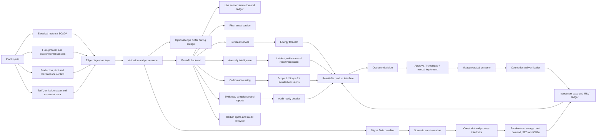
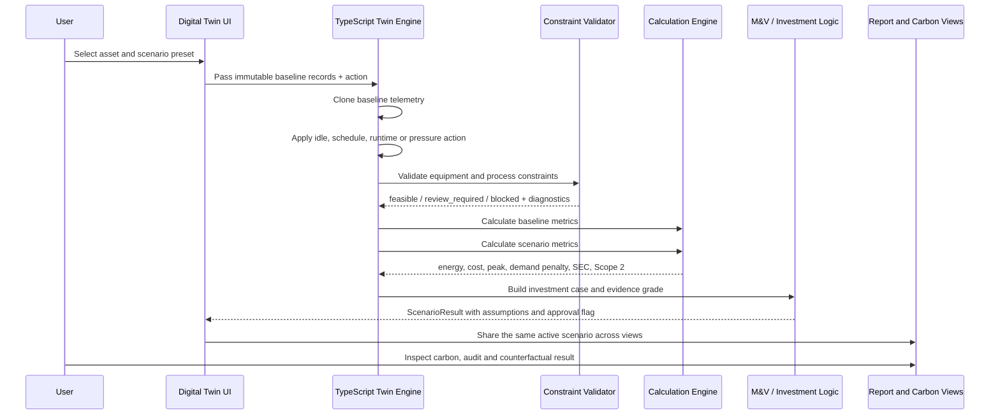
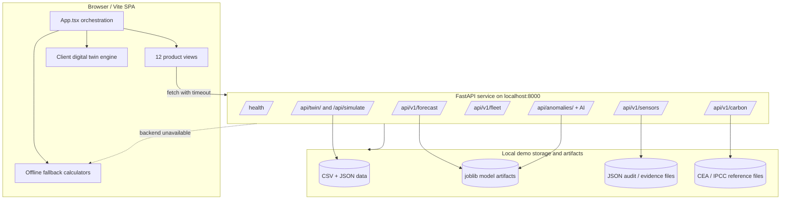
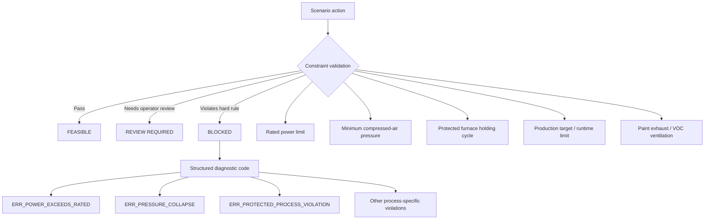
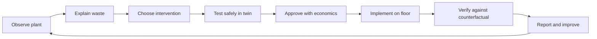
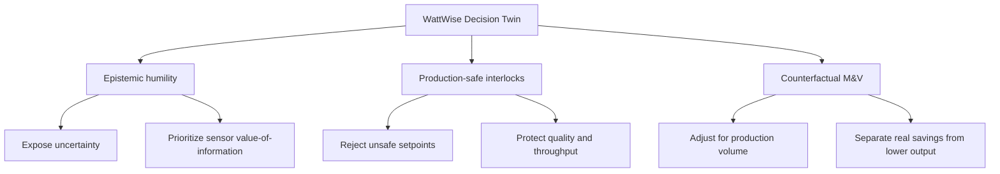
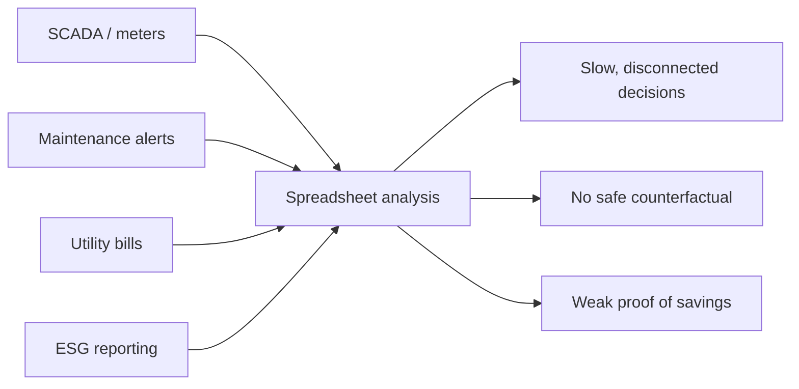
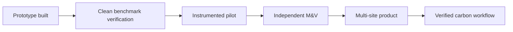

# WattWise AI
## Final Technical Review & Product Pitch Playbook

**Purpose:** understand the complete end-to-end system as it exists today, identify what is genuinely implemented versus simulated or aspirational, and convert that understanding into a credible product-led final-review presentation.

**Project:** WattWise AI — Industrial Energy Intelligence, Digital Twin and Carbon Accounting

**Target context:** KPCL / Kirloskar Pneumatic sustainable-manufacturing hackathon

**Review date:** 25 October 2026

---

## 1. The one-sentence product

> WattWise AI helps an industrial plant detect energy waste, test operational changes in a physics-constrained digital twin, quantify cost and Scope 2 impact, and produce an evidence trail for management and audit review.

The strongest product idea is not “a 3D factory dashboard.” The strongest idea is:

> **Before changing a live factory, test the decision, its safety constraints, its expected economics and its carbon impact in a governed counterfactual twin. Then measure whether the saving actually happened.**

This makes WattWise a decision-and-verification layer for industrial energy management, rather than another visualization layer.

---

## 2. Executive assessment: how proper is the system today?

### Overall verdict

**Hackathon prototype maturity: strong. Production maturity: not yet.**

The project has unusually broad end-to-end coverage for a hackathon:

- A production-buildable React/Vite application with executive, engineering, SCADA, forecasting, anomaly, carbon, evidence and audit views.
- A FastAPI backend with health, sensor, fleet, forecast, anomaly, carbon, compliance, audit-report and credit endpoints.
- A deterministic TypeScript digital twin with baseline immutability, scenario actions, tariffs, demand penalties, Scope 2 calculation, constraints and M&V outputs.
- Trained model artifacts and evaluation reports for anomaly detection and energy forecasting.
- A cryptographic hash-chain demo ledger, evidence vault and report-generation workflow.
- Automated tests covering many backend flows, although the current machine could not execute them because no Python interpreter is installed.

The main caveat is equally important:

> **The current evidence base is synthetic and demo-oriented. The system demonstrates the workflow and engineering logic; it does not yet prove savings, model performance or carbon-credit eligibility on a real KPCL plant.**

That is not a weakness to hide. It is the correct stage-gated story: **validated prototype → instrumented pilot → independently verified deployment**.

### Evidence-status legend

| Status | Meaning in this document |
|---|---|
| **Implemented** | Present in source code and wired into the application or API. |
| **Demonstrated** | Works against synthetic data, local fixtures or deterministic demo inputs. |
| **Fallback** | The UI intentionally computes a local result when the backend is unavailable. |
| **Prototype claim** | A useful design target or demo result that still needs field validation. |
| **Production gap** | Required before a customer can rely on it for operational, regulatory or financial decisions. |

---

## 3. System map: complete end-to-end pipeline



### What happens when a user clicks “simulate”



### Runtime topology



---

## 4. What is actually in the repository

### Frontend product surface

`src/App.tsx` defines the main application shell and 12 navigable product views:

| View | Product job | Current implementation status |
|---|---|---|
| Overview | Plant KPIs, live/near-live status, alerts and action shortcuts | Implemented; mixes API data with local demo defaults. |
| Executive View | Management-facing plant health and sustainability narrative | Implemented. |
| Diagnostics Cockpit | Engineering telemetry, sensor and diagnostic detail | Implemented; several readings are simulated. |
| 3D Factory Twin | Visual SCADA-style physical context | Implemented with Three.js and 2.5D alternative. |
| Digital Twin | Counterfactual scenario simulation and interlocks | Implemented primarily in the client-side TypeScript engine. |
| Plant-Wide Fleet | 50-asset library, coverage and fleet attention queue | Implemented with backend service plus grounded fallback catalog. |
| Carbon Quotas & Ledger | Quota burn-rate checks and ledger visibility | Implemented. |
| Energy Forecast | 15-minute, daily, weekly and plant forecast surfaces | Implemented with backend and fallback paths. |
| Carbon Accounting | Scope 1, Scope 2, avoided emissions and factors | Implemented; demo data and configurable factors. |
| Evidence Vault | Evidence documents, quality checks and traceability | Implemented. |
| AI Anomaly Intelligence | Incidents, recommendations, reports and live simulation | Implemented against synthetic data and saved model artifacts. |
| Audit Report | Report generation, downloads and M&V presentation | Implemented. |

### Backend route groups

The FastAPI application (`backend/app/main.py`) registers:

- `/health` — service readiness and model-load status.
- `/api/v1/sensors/*` — topology, live telemetry, outage buffering and audit-ledger verification.
- `/api/v1/forecast/*` — next 15 minutes, next day, next week, plant forecast and model metadata.
- `/api/v1/fleet/*` — assets, overview, coverage, attention queue and analytics execution.
- `/api/anomalies/*`, `/api/dashboard/summary`, `/api/forecast/*` — anomaly operations, incident lifecycle and recommendations.
- `/api/v1/ai/*` and `/api/ai/*` — local AI status, explain and chat endpoints.
- `/api/v1/carbon/*` — factors, carbon calculation, quota, ledger, credits, compliance, evidence, traceability and reports.
- `/api/twin/*`, `/api/simulate`, `/api/optimize` — digital-twin machine/config/baseline access, scenario simulation and schedule optimization.

The route catalogue is broader than the minimum demo because the project is already structured as a platform, not only as a single dashboard.

---

## 5. Technical deep dive

### 5.1 Input data and provenance

The project has several distinct data layers. They should be described separately in the presentation:

| Data layer | Repository evidence | Role |
|---|---|---|
| Digital-twin demo baseline | `data/machine_energy.csv`, machine profiles and tariff JSON | Deterministic hourly scenario calculations for the four core assets. |
| Forecasting benchmark | `industrial_energy_forecasting_synthetic.csv` | Six-month, multi-site/machine synthetic benchmark with 740,748 rows. |
| AI anomaly benchmark | `backend/ai_intelligence/data/synthetic_v1/telemetry.csv` | 30 days × 4 machines × 5-minute samples = 34,560 rows. |
| Reference factors | CEA and IPCC files under `backend/data/reference/` | Factor and methodology context for carbon calculations. |
| Demo persistence | `backend/data/evidence_vault/`, `audit_ledger.json` and report outputs | Local workflow state, evidence and audit-chain persistence. |
| Frontend catalog | `src/data/mockData.ts`, `data/machineLibrary.json` and fallback service catalogs | UI-first experience when API data is unavailable. |

Important provenance language for the pitch:

- Say **“synthetic telemetry benchmark”**, not “plant telemetry,” unless a real connected plant is being shown.
- Say **“model-estimated avoidable energy”**, not “verified savings,” for anomaly outputs.
- Say **“carbon-credit workflow prototype”**, not “issued market credits,” unless an accredited verification and registry record exists.

### 5.2 Frontend orchestration and offline behavior

The UI uses `VITE_API_BASE_URL`, defaulting to `http://127.0.0.1:8000` for backend calls. The main app:

1. Starts in a demo-friendly experience.
2. Checks backend health and factor availability.
3. Polls a live simulation tick approximately every two seconds.
4. Uses API data when calls succeed.
5. Falls back to deterministic local calculations when calls fail.
6. Labels the state as `CONNECTED` or `OFFLINE (DEMO)`.

This is a strong demo feature because the product remains explorable without a running backend. It is also a governance concern: a production deployment must make it impossible to confuse fallback estimates with live plant measurements. The pitch should show the status badge and explicitly explain the provenance label.

### 5.3 Digital twin calculation path

The TypeScript twin is composed of:

- `twinProfiles.ts` — asset ratings, expected idle power, off power and constraints.
- `baselineEngine.ts` — baseline telemetry and 24-hour baseline extraction.
- `scenarioEngine.ts` — immutable clone and scenario transformation.
- `constraintValidator.ts` — process and physical interlocks.
- `calculationEngine.ts` — energy, cost, demand, peak, SEC and Scope 2 metrics.
- `optimizer.ts` — candidate schedule search for peak-demand reduction.
- `confidenceEngine.ts` — investment case, evidence grade and value-of-information logic.
- `mvLedger.ts` — realized-savings record structure.

The supported action types are:

- `reduce_idle_power`
- `shift_schedule`
- `reduce_runtime`
- `pressure_optimization`

The scenario engine applies an action to a copied record set. It does not mutate the baseline. That is important because all comparisons must be traceable to the same reference.

#### Core equations

For each interval:

```text
interval_energy_kwh = average_power_kw × interval_duration_hours
plant_power_kw[t]  = Σ machine_power_kw[m,t]
peak_demand_kw     = max(plant_power_kw[t])
SEC                 = total_energy_kwh / total_production_units
energy_cost        = Σ interval_energy_kwh × time_of-day_rate
demand_penalty     = max(0, peak_demand_kw − contract_limit_kw) × penalty_rate
Scope 2 kgCO2e     = purchased_electricity_kwh × grid_emission_factor
```

The default digital-twin tariff configuration is:

- Off-peak: ₹7.65/kWh.
- Normal: ₹9.00/kWh.
- Peak: ₹10.80/kWh.
- Contract demand limit: 85 kW.
- Demand exceedance penalty: ₹350/kW.

The default demo grid factor in the twin data is 0.82 kgCO2e/kWh, sourced in the repository to CEA India v19 for 2023–24. The broader carbon UI also supports a 0.72886 kgCO2e/kWh CEA v22 factor. This must be resolved before a production or competition claim: **one reporting period and one selected factor must be visible in every affected view.**

### 5.4 Interlocks and governance

The twin is differentiated by preventing unsafe recommendations from looking like valid optimization results.



The canonical four-asset demo profiles are:

| Asset | Rated power | Example hard constraint |
|---|---:|---|
| `COMP-01` Air Compressor | 30 kW | Ring-main pressure must remain at or above 6.5 bar. |
| `CNC-01` CNC Machining Center | 25 kW | Daily production target and maximum continuous runtime. |
| `FURN-01` Industrial Furnace | 50 kW | Protected holding cycle; cutting below 15 kW risks quench defects. |
| `PAINT-01` Painting / Exhaust | 20 kW | Ventilation must remain active during painting. |

There is a naming mismatch in the broader UI where the fourth asset is sometimes surfaced as `cooling` / `CHILLER-01`. Resolve this before the final demo so the audience sees one consistent plant model.

### 5.5 AI anomaly intelligence

The anomaly pipeline combines feature engineering, supervised classification, unsupervised detection, operating-condition baselines, residual logic, recommendations, incident storage and report generation.

The saved model metadata reports a supervised Random Forest as the selected prototype. The held-out chronological test results are:

| Model | Precision | Recall | F1 | ROC-AUC | PR-AUC | Interpretation |
|---|---:|---:|---:|---:|---:|---|
| Supervised Random Forest | 0.6087 | 0.2917 | 0.3944 | 0.998 | 0.6278 | Conservative, low false-positive prototype; misses many positives. |
| Isolation Forest | 0.1765 | 1.0000 | 0.3000 | 0.968 | 0.1213 | High recall, noisy alerting; useful as a screening path. |
| Energy baseline detector | 0.0000 | 0.0000 | 0.0000 | — | — | Requires calibration before it is presented as a model winner. |

The report itself records 48 held-out health anomalies and 552 excess-energy alerts in the evaluated synthetic report. That is useful for demonstrating incident operations, but do not present the numbers as real-factory prevalence.

### 5.6 Energy forecasting

The energy forecasting service exposes 15-minute, daily, weekly and plant-wide horizons. The selected artifact is a `HistGradientBoostingRegressor`, selected over persistence, same-hour and Random Forest baselines.

Chronological test result for the selected model:

- Test records: 111,098.
- MAE: 0.9403 kWh.
- RMSE: 1.4763 kWh.
- R²: 0.6522.
- WAPE: 42.57%.

This is a reasonable prototype benchmark, not a production-grade accuracy guarantee. The validation set is synthetic and should be recalibrated using real plant history, machine-specific sampling and forecast-horizon acceptance thresholds.

### 5.7 Carbon accounting and compliance workflow

The backend carbon service covers:

- Scope 1 stationary-combustion activity inputs.
- Process, refrigerant, welding-gas and wastewater activity structures.
- Scope 2 purchased electricity.
- Avoided-emissions comparisons.
- Grid-factor metadata.
- Carbon quota / burn-rate checks.
- Audit ledger blocks and verification.
- Evidence documents, quality checks and metric traceability.
- Corporate report generation and PDF/report-pack downloads.
- Compliance dossier pathways for ISO 14064, IPMVP, SEBI BRSR and EU CBAM.
- Credit portfolio, additionality, issue and retirement workflow.

The system therefore presents a full accounting-to-reporting lifecycle. However, an API that can issue a demo credit is not evidence that a real credit is eligible. Real issuance requires approved methodology, project additionality, monitoring, validation, verification, registry acceptance and retirement controls.

### 5.8 Audit ledger and edge outage behavior

The sensor simulation service demonstrates:

1. A physical-sensor topology.
2. High-frequency telemetry ticks.
3. A 72-hour edge buffer during a simulated outage.
4. Replay on reconnection.
5. SHA-256 chained blocks with previous-hash and current-hash fields.
6. Whole-chain verification.

For a pitch, call this **tamper-evident audit provenance**. Do not call the local JSON file a fully immutable ledger. Production immutability would require controlled storage, access management, key custody, append-only retention, backups and an independent verification boundary.

---

## 6. What the system proves, and what it does not prove

| The demo proves | The demo does not yet prove |
|---|---|
| A plant energy decision can be represented as a scenario action. | The action will produce the same saving on a real machine. |
| Energy, cost, demand and Scope 2 deltas can be calculated consistently from a baseline. | A plant’s reported carbon inventory is independently assured. |
| Unsafe or process-incompatible actions can be blocked. | Every plant-specific process constraint has been encoded correctly. |
| Forecasting and anomaly models can be trained, evaluated and exposed through APIs. | Model performance generalizes to unseen factories, machines and sensor calibrations. |
| Evidence, traceability and report workflows can be represented in one product. | A regulator, auditor or registry will accept the generated dossier without review. |
| A connected/fallback user experience can be demonstrated. | Offline fallback values are live plant readings. |
| A carbon-credit lifecycle can be modelled. | The project has issued tradable or compliance-valid credits. |

This distinction should appear on the final review slide as “current proof” versus “pilot validation plan.” It increases credibility.

---

## 7. System risks and review actions before presenting

### P0 — resolve before the final demo

1. **Pick one source of truth for factors and tariffs.** The codebase contains multiple factor/tariff contexts, including 0.82 versus 0.72886 kgCO2e/kWh and different UI tariff labels. Show the selected reporting period and factor beside every carbon number.
2. **Make provenance impossible to miss.** Every KPI should carry `LIVE`, `SIMULATED`, `FALLBACK` or `MODEL ESTIMATE`.
3. **Use one asset taxonomy.** Align `PAINT-01` versus `cooling` / `CHILLER-01`, and align the four-asset twin with the 50-asset fleet catalog.
4. **Do a clean demo reset.** Local evidence and workflow JSON can retain prior state. Start from a known scenario ID and known baseline.
5. **Do not claim field traction.** Present synthetic datasets, completed prototype surfaces and model artifacts as technical traction; use a pilot as the next milestone.

### P1 — required for a credible pilot

1. Replace local JSON state with a transactional database and append-only audit storage.
2. Add authentication, authorization and tenant isolation at the API layer, not only a UI role selector.
3. Connect to real SCADA/OPC-UA/Modbus or historian exports with clock synchronization and data-quality gates.
4. Calibrate the forecast and anomaly models using plant-specific historical data.
5. Establish baseline and reporting-period rules with an energy auditor; keep production volume and operating conditions in the M&V record.
6. Add independent review gates for scenario approval, implementation and credit issuance/retirement.
7. Add observability: request logs, model version, factor version, scenario input hash, output hash and operator identity.

### P2 — product hardening

1. Split the large frontend bundle using lazy-loaded routes; the production build warns that the main JavaScript chunk is above 500 kB.
2. Add contract tests between the TypeScript services and FastAPI response schemas.
3. Add a model registry and drift monitoring.
4. Add localization of units, timezone and currency per plant.
5. Add approval workflows for changing tariffs, emission factors and constraint profiles.
6. Add a formal threat model for sensor spoofing, credential abuse and report tampering.

---

## 8. Verification status from this workspace

### Completed in this review

- Inspected the frontend, backend, model artifacts, synthetic data cards, reports, API routers and digital-twin source.
- Ran `npm run build` successfully.
- Confirmed TypeScript compilation and Vite production bundling complete.
- Confirmed the repository already contains broad backend test coverage by source inspection.

### Not executable on this machine

The backend test command could not run because the Windows Python launcher reports **“No installed Python found.”** This is an environment limitation, not a test failure. Before final review, run the suite in the project’s intended Python environment:

```powershell
cd "C:\Users\Utkarsh Ghom\Downloads\kirlosker hack\Carbon-Accounting-and-smart-Manufacturing"
python -m pytest backend/tests tests -q
```

If Python is installed through another environment, activate it first. Capture the final result and put the pass count on the technical-review slide.

### Suggested final verification matrix

| Check | Command / action | Evidence to capture |
|---|---|---|
| Frontend build | `npm run build` | Build passes; note bundle warning if unchanged. |
| Backend tests | `python -m pytest backend/tests tests -q` | Pass count and failures. |
| Backend health | Start FastAPI, call `/health` | Models, services and version. |
| API schema | Open `/docs` | Route groups and response contracts. |
| Twin feasible case | Run compressor idle or CNC stagger preset | Scenario ID, feasible status and deltas. |
| Twin blocked case | Run rated-power or furnace interlock preset | Error code and blocked status. |
| Forecast | Request 15-minute and plant horizon | Model metadata and provenance. |
| Anomaly | Open anomaly report and incident detail | Evidence, confidence and recommendation. |
| Carbon | Calculate with a named reporting factor | Scope 1, Scope 2, gross and avoided emissions. |
| Ledger | Verify audit chain | Hash-chain verification response. |
| Report | Generate audit PDF / pack | File opens and contains scenario/evidence metadata. |

---

## 9. Product pitch narrative

### The story in 30 seconds

> Industrial plants are under pressure to reduce energy bills, carbon emissions and audit effort, but the people responsible for production cannot safely act on a black-box recommendation. WattWise AI connects plant telemetry to an explainable decision twin. It identifies waste, simulates the change, blocks unsafe actions, shows the cost and carbon outcome, and preserves the evidence required to verify the result later. We are starting with energy-intensive manufacturing, where every avoided peak, idle loss and unverified carbon claim has a direct operational cost.

### The problem / gap

Industrial sustainability is fragmented:

1. SCADA shows what is happening but rarely explains the business consequence.
2. Energy dashboards report consumption but do not safely test operational changes.
3. AI anomaly tools alert maintenance teams but often lack production constraints and audit context.
4. Carbon tools calculate emissions after the period, often from invoices and spreadsheets.
5. Auditors need evidence, while operators need speed and safety.
6. Finance needs a defensible payback case, not a generic “AI can save energy” claim.

The gap is the missing decision loop:



Most point tools stop at **observe** or **report**. WattWise is designed around the full loop.

### The solution

WattWise has five product layers:

1. **Sense:** ingest electrical, fuel, process, ambient and production context.
2. **Understand:** forecast energy and detect anomalous operating behavior.
3. **Decide:** simulate scenarios in a baseline-preserving digital twin.
4. **Protect:** enforce physical, process, production and carbon guardrails.
5. **Prove:** record evidence, M&V results, carbon factors and audit outputs.

### The product differentiator



Competitors may provide dashboards, anomaly alerts, carbon calculators or generic digital twins. WattWise connects those functions to an operational decision with guardrails and evidence.

---

## 10. Demo plan: a reliable 5–6 minute sequence

### Demo objective

Do not try to show every view. Show one coherent chain from problem to verified decision.

### Step 0 — Establish provenance, 20 seconds

Say:

> “This is a synthetic PrecisionWorks plant benchmark used to demonstrate the workflow. The UI clearly distinguishes connected, simulated and fallback data.”

Point to the backend status and data-provenance label. This prevents the jury from having to ask whether the numbers are real.

### Step 1 — Show the plant problem, 40 seconds

Open Overview or Executive View.

Show:

- Plant demand and cost.
- One active anomaly or high-priority asset.
- The compressed-air or furnace problem.
- The business consequence: wasted kWh, potential peak charge, carbon impact and maintenance priority.

Suggested line:

> “The plant can see a power draw, but the decision is not simply ‘turn it down.’ The question is whether we can reduce it without violating pressure, production or process constraints.”

### Step 2 — Explain the anomaly, 45 seconds

Open AI Anomaly Intelligence.

Show:

- Equipment and anomaly type.
- Actual versus expected power or process variable.
- Confidence and evidence trail.
- Recommendation.

Say:

> “The model is not allowed to hide its uncertainty. It gives an evidence trail and a recommended next action. In a real plant, this is where we would distinguish a controllable idle loss from a leak or a sensor problem.”

### Step 3 — Run the digital twin, 90 seconds

Open Digital Twin.

Recommended order:

1. Baseline: show energy, cost, peak demand, SEC and Scope 2.
2. Apply compressor idle-power reduction or pressure optimization.
3. Show baseline versus scenario curve.
4. Show feasible status and savings delta.
5. Show investment case and evidence grade.

Say:

> “The twin clones the baseline, applies the action, recalculates every dependent metric and preserves the original baseline. This is a simulation, not an automatic command to the machine.”

### Step 4 — Prove the safety interlock, 45 seconds

Run the blocked scenario.

Show the red blocked state and diagnostic code.

Suggested line:

> “If the proposed setting exceeds rated power, collapses the compressed-air pressure floor or cuts a protected furnace cycle, WattWise blocks the recommendation. A lower energy number is not a good outcome if the batch, quality or operator safety is compromised.”

### Step 5 — Show cross-product continuity, 60 seconds

Click Apply / carry the active scenario into:

- Carbon Accounting.
- Audit Report.
- Evidence Vault or traceability drawer.

Show that scenario ID, assumptions, factor metadata and deltas remain connected.

### Step 6 — Close with verification, 40 seconds

Show:

- Counterfactual adjusted baseline.
- M&V ledger entry.
- Audit hash-chain verification or report pack.

Close with:

> “The value is not only finding a saving. The value is making the saving safe to implement and defensible to verify.”

### Demo fallback plan

If the backend is unavailable:

1. Keep the UI running in `OFFLINE (DEMO)`.
2. State that the digital twin and fallback path are local deterministic calculations.
3. Do not open a backend-dependent screen unless its fallback data is already loaded.
4. Avoid claiming live telemetry.

---

## 11. Slide-by-slide product pitch

### Slide 1 — Title / promise

**WattWise AI: from factory telemetry to safe, verifiable energy decisions**

Visual: one clean flow from anomaly → twin → safe action → verified carbon/cost result.

Speaker line:

> “We help manufacturers reduce energy cost and carbon without asking them to gamble with production.”

### Slide 2 — The factory gap

Show the fragmented toolchain:



Message: data exists, but the operational decision loop is broken.

### Slide 3 — Why existing approaches fail

Use a three-column contrast:

| Existing approach | What it does well | Missing layer |
|---|---|---|
| Dashboard | Visibility | Safe action and causal verification |
| Alerting tool | Finds deviations | Production context and economics |
| Carbon spreadsheet | Periodic accounting | Real-time intervention and provenance |
| Generic digital twin | Visualizes a facility | Decision guardrails and M&V |

### Slide 4 — Solution architecture

Use the end-to-end Mermaid pipeline from Section 3. Keep it simplified on the actual slide and move the full diagram to backup.

### Slide 5 — Live product walkthrough

Show the actual application in this order:

1. Overview.
2. AI anomaly.
3. Digital Twin.
4. Blocked interlock.
5. Carbon and audit report.

The slide should contain only the product screenshots and three labels: **Detect → Decide → Prove**.

### Slide 6 — Technical defensibility

Show the deterministic engine:

- Baseline is immutable.
- Actions are typed.
- Constraints run before recommendation approval.
- Metrics are recalculated from telemetry, tariff and factor inputs.
- Assumptions and provenance are retained.

Add one blocked scenario and one feasible scenario.

### Slide 7 — Traction / evidence today

Use honest prototype traction:

| Evidence | Current proof |
|---|---|
| Product surface | 12 integrated views in a production build. |
| Backend surface | FastAPI route groups for sensors, fleet, forecast, AI, carbon, audit and credits. |
| Digital twin | Deterministic scenario engine, optimizer, constraints and M&V structures. |
| AI benchmark | Chronological synthetic evaluation artifacts for anomaly and forecast models. |
| Reporting | Evidence vault, traceability and report-pack workflows. |
| Next validation | One instrumented manufacturing pilot with real historian data. |

Do not label synthetic benchmark numbers as customer traction.

### Slide 8 — Competition

Use a capability matrix, not a logo wall:

| Capability | Dashboard / BI | CMMS / EAM | Carbon accounting | Generic AI alerting | WattWise |
|---|---:|---:|---:|---:|---:|
| Plant energy visibility | ✓ | Partial | Partial | Partial | ✓ |
| Machine-level anomaly reasoning | Partial | Partial | — | ✓ | ✓ |
| Counterfactual scenario simulation | — | — | — | Partial | ✓ |
| Physical/process interlocks | — | Partial | — | — | ✓ |
| Cost + demand + carbon in one scenario | Partial | — | ✓ | — | ✓ |
| Evidence and M&V continuity | Partial | Partial | ✓ | Partial | ✓ |
| Carbon-credit workflow | — | — | ✓ | — | ✓ |

Position carefully: WattWise is not claiming to replace SCADA, ERP, EAM or an accredited verifier. It sits above plant data and connects operational decisions to financial and carbon proof.

### Slide 9 — Where we stand



Current position: **P0, approaching P1 after a clean environment run.**

Next 90 days:

- Secure one pilot plant and one defined use case.
- Integrate historian/SCADA export.
- Calibrate the asset taxonomy and constraints.
- Establish a 30–90 day baseline.
- Validate one intervention with production-quality M&V.

### Slide 10 — Business model / money

Primary revenue model:

1. **Site subscription:** recurring software fee per plant / facility.
2. **Onboarding and integration:** historian, SCADA, meter and asset-model setup.
3. **Premium modules:** fleet analytics, compliance packs, audit evidence and optimization.
4. **Verification services:** implementation support and M&V coordination with qualified auditors.
5. **Optional sensor / edge bundle:** hardware integration and gateway support; do not require WattWise-owned hardware.

Example pricing hypothesis for discussion, not a validated market quote:

| Package | Indicative target |
|---|---:|
| Pilot / diagnostic | ₹2–5 lakh one-time |
| Single-site software | ₹6–18 lakh per year |
| Enterprise multi-site | ₹25 lakh+ per year, integration-dependent |

The commercial value case is:

```text
Annual customer value
= avoided energy charges
  + avoided demand penalties
  + maintenance loss avoided
  + audit/reporting effort reduced
  + potential verified carbon value
```

Lead with energy and production economics. Treat carbon-credit revenue as an upside dependent on eligibility and verification, not as the only reason to buy.

### Slide 11 — Why now: energy, climate and carbon policy

Use three evidence-backed forces:

1. **Industrial energy pressure:** the IEA reports that industry accounts for nearly 40% of global final energy demand and that industrial demand has been a major driver of energy-demand growth. See [IEA Energy Efficiency 2025 — Industry](https://www.iea.org/reports/energy-efficiency-2025/industry).
2. **Climate volatility:** WMO’s October 2026 update describes a strengthening El Niño and increased risk of above-average temperatures and shifted rainfall patterns. See [WMO — Sea-surface temperatures reflect strengthening El Niño](https://public.wmo.int/media/news/sea-surface-temperatures-reflect-strengthening-el-nino).
3. **Indian carbon-market infrastructure:** BEE describes the Indian Carbon Market as having compliance and offset mechanisms, with each carbon credit certificate representing one tonne of CO2e reduction or removal. See [BEE — Carbon Market](https://beeindia.gov.in/show_content.php?lang=1&level=1&lid=294&ls_id=116) and the [CCTS notification](https://beeindia.gov.in/sites/default/files/CCTS%20Notification.pdf).

How to connect El Niño without overclaiming:

> “El Niño is not the cause of every plant’s energy waste, but it is a useful risk context: hotter ambient conditions can raise cooling and compressor loads, change production conditions and increase peak-demand stress. WattWise already models ambient temperature as an input and can help plants test resilient operating choices before a hotter or more volatile season.”

Do not say “El Niño creates our market.” Say it **increases the urgency of operational resilience, energy efficiency and auditable emissions reduction.**

### Slide 12 — Audience and market

#### Initial buyer

- Plant head / factory manager.
- Energy manager.
- Maintenance and reliability leader.
- ESG / sustainability controller.
- CFO or operations finance sponsor.

#### Initial beachhead

- Indian discrete and heavy manufacturing.
- Compressor-, furnace-, CNC-, chiller- and paint-intensive plants.
- Plants with meaningful demand charges, multiple shifts and export/reporting pressure.
- Multi-site groups that need a common energy and carbon evidence layer.

#### Buying trigger

- High energy bill or demand penalty.
- Repeated unexplained idle or peak load.
- New BRSR / customer decarbonization reporting requirement.
- Export customer asking for embedded-carbon evidence.
- Planned retrofit whose payback is uncertain.

#### Bottom-up market model

Avoid unsupported top-down market numbers in the final pitch. Use a bottoms-up model and label every assumption:

```text
Serviceable annual opportunity
= target number of industrial sites × annual contract value

Illustrative scenario only:
1,000 target sites × ₹12 lakh ACV = ₹120 crore annual opportunity

Illustrative first wedge:
25 sites × ₹12 lakh ACV = ₹3 crore ARR
```

Replace the 1,000-site assumption with a defensible count from a named customer list, industrial cluster or channel partner before using it as a market fact.

### Slide 13 — Carbon credits and monetization guardrail

Explain the lifecycle:

```mermaid
flowchart LR
    Baseline[Approved baseline] --> Intervention[Implemented intervention]
    Intervention --> Monitor[Meter and monitor]
    Monitor --> Quantify[Quantify avoided emissions]
    Quantify --> Additionality[Additionality and leakage checks]
    Additionality --> Validate[Independent validation / verification]
    Validate --> Registry[Registry or market acceptance]
    Registry --> Issue[Issue / transfer / retire]
```



WattWise can help create the data and evidence layer for this lifecycle. It should not promise automatic credits. The product’s immediate value is still defensible energy savings, demand reduction, carbon accounting and audit readiness.

### Slide 14 — Closing ask

> “We are looking for one manufacturing pilot where we can connect real telemetry, prove one energy intervention against a counterfactual baseline and turn that verified result into a repeatable deployment playbook.”

This is a stronger ask than generic funding or “more data.” It gives the jury a concrete next step.

---

## 12. Speaker notes for difficult questions

### “Is this real data?”

> “The current demo uses synthetic benchmark data and deterministic plant profiles so we can demonstrate the entire workflow safely. We deliberately label it as simulated. The next validation step is to connect a real historian and calibrate the twin with plant-specific constraints.”

### “Can the AI control the machine?”

> “Not in the current product. The current system is decision support. It simulates, explains and requires operator approval. Any future closed-loop control would need a separate safety case and integration review.”

### “How do you prevent bad AI recommendations?”

> “The recommendation path is constrained by rated power, pressure floors, protected process blocks, production requirements and ventilation rules. A hard violation returns a blocked status and diagnostic code.”

### “How do you prove savings?”

> “We preserve an immutable baseline, adjust it for production volume, compare it with measured actuals, and store the realized result in an M&V ledger. The demo shows the calculation; an independent pilot audit is the next validation step.”

### “Are these carbon credits tradable?”

> “The repository contains a credit lifecycle prototype, not a claim of registry-issued credits. Tradability depends on methodology, additionality, monitoring, independent verification and registry acceptance.”

### “What is your moat?”

> “The moat is the decision graph: asset-aware constraints, scenario economics, uncertainty, evidence and counterfactual M&V connected in one operational workflow. A dashboard can be copied; a validated plant constraint and verified intervention history become harder to replace.”

### “What if the backend goes down?”

> “The UI has an explicit offline demo fallback, but it is labelled. In production, fallback mode would be read-only and would never be allowed to masquerade as live operational telemetry.”

---

## 13. Final 90-second pitch script

> “Manufacturing plants are full of energy data, but the data does not automatically become a safe operational decision. A compressor may be wasting power, a furnace may be creating a peak, and a carbon report may still depend on disconnected spreadsheets. The plant manager has to choose between saving energy and risking production.
>
> WattWise AI closes that gap. It ingests plant and production context, detects abnormal energy behavior, and lets the operator test a proposed change in a deterministic digital twin. The twin recalculates energy, cost, peak demand, production efficiency and carbon impact. Before a result is accepted, it checks physical and process constraints: pressure floors, rated power, furnace holding cycles, production targets and ventilation requirements.
>
> In our demo, we start with an anomalous industrial asset, simulate an efficiency intervention, show the baseline-versus-scenario result, then intentionally request an unsafe change. WattWise blocks it and explains why. We carry the approved scenario into carbon accounting, evidence traceability and the audit report, so the saving is not only estimated — it is prepared for later measurement and verification.
>
> Today, this is a complete synthetic-data prototype with a working product surface, backend services, model artifacts, constraint engine and reporting workflow. We are explicit that it is not yet field-validated. Our next step is one instrumented manufacturing pilot, one verified intervention and one repeatable deployment playbook.
>
> The timing is strong: industrial energy demand remains material, climate volatility increases operational stress, and India’s carbon-market infrastructure is developing. WattWise gives manufacturers a practical path to save money now while building credible carbon evidence for later.
>
> We are not asking factories to trust black-box AI. We are giving them a safer way to decide, implement and prove.”

---

## 14. Final presenter checklist

### Before the room

- [ ] Run frontend build.
- [ ] Run backend tests in a working Python environment.
- [ ] Start FastAPI and confirm `/health`.
- [ ] Open the app with backend connected once.
- [ ] Confirm the factor, tariff and reporting period shown in every view.
- [ ] Confirm asset names are consistent.
- [ ] Reset local evidence/workflow state to a clean demo scenario.
- [ ] Prepare screenshots or screen recording in case the live app fails.
- [ ] Decide who presents product, engineering and business sections.

### During the demo

- [ ] Say synthetic / simulated before showing numbers.
- [ ] Show one problem, one feasible scenario and one blocked scenario.
- [ ] Do not click randomly through all 12 views.
- [ ] Show the backend status badge.
- [ ] Show the scenario ID and feasibility state.
- [ ] End on verified evidence, not on a decorative 3D scene.

### Claims to avoid

- [ ] “We have reduced a real plant’s energy by X%” unless a signed pilot result exists.
- [ ] “Our AI detects all anomalies.”
- [ ] “We issue tradable carbon credits automatically.”
- [ ] “The ledger is impossible to tamper with.”
- [ ] “El Niño directly causes this plant’s emissions.”
- [ ] “The model generalizes to every factory.”

### Claims that are safe and strong

- [ ] “We built a complete end-to-end prototype.”
- [ ] “The twin prevents unsafe scenario assumptions.”
- [ ] “The current benchmark is synthetic and explicitly labelled.”
- [ ] “The next proof point is a real, instrumented pilot with independent M&V.”
- [ ] “We connect operational savings to carbon and audit evidence in one workflow.”

---

## 15. Code and artifact map for reviewers

| Area | Key files |
|---|---|
| App shell and navigation | `Carbon-Accounting-and-smart-Manufacturing/src/App.tsx` |
| Digital twin types | `src/digitalTwin/types.ts` |
| Digital twin scenario execution | `src/digitalTwin/scenarioEngine.ts` |
| Metrics and tariff calculations | `src/digitalTwin/calculationEngine.ts` |
| Constraints | `src/digitalTwin/constraintValidator.ts` |
| Baseline | `src/digitalTwin/baselineEngine.ts` |
| Optimization | `src/digitalTwin/optimizer.ts` |
| M&V ledger | `src/digitalTwin/mvLedger.ts` |
| Frontend API clients | `src/services/*.ts` |
| FastAPI entry point | `backend/app/main.py` |
| Carbon API | `backend/app/routers/carbon.py` |
| Forecast API | `backend/app/routers/forecast.py` |
| Anomaly API | `backend/app/routers/anomalies.py` |
| Sensor and hash-chain API | `backend/app/routers/sensors.py` |
| Fleet API | `backend/app/routers/fleet.py` |
| Forecast model evaluation | `ml/energy_forecasting/reports/evaluation_report.json` |
| Anomaly model metadata | `backend/ai_intelligence/models/model_metadata.json` |
| Synthetic anomaly data card | `backend/ai_intelligence/data/synthetic_v1/dataset_card.md` |
| Generated anomaly report | `backend/ai_intelligence/reports/ANOMALY_DETECTION_REPORT.md` |
| Frontend build command | `package.json` |

---

## Bottom line

WattWise AI is ready to present as a **credible, technically serious hackathon prototype**. The pitch should lead with the decision loop and production safety, use the digital twin as the hero demo, and use carbon credits as a downstream monetization and evidence opportunity rather than the core promise.

The most important sentence for the team to remember is:

> **We have built the machinery for trustworthy industrial energy decisions; the next milestone is proving it on real plant data under independent measurement and verification.**

