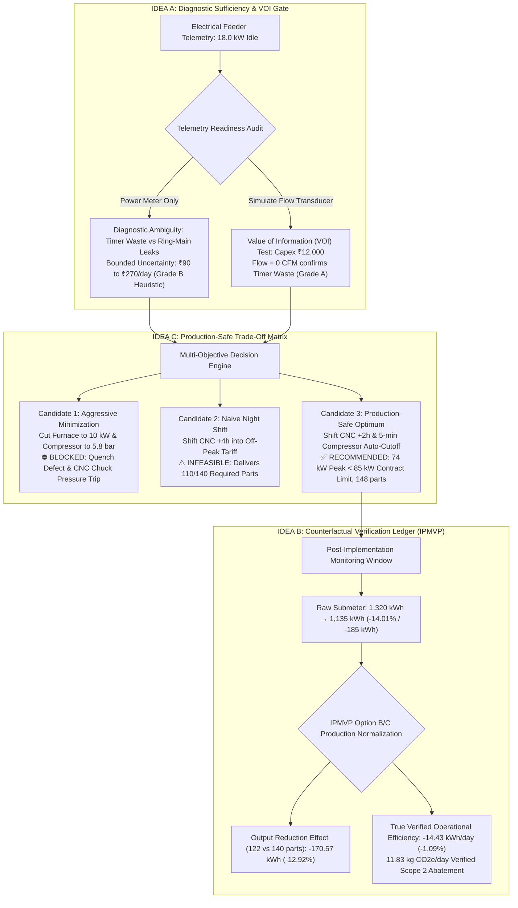

# WattWise AI — Operational Decision & Counterfactual Digital Twin
## Master Architecture, Technical Specification & Implementation Plan — Version 2.0
**KPCL Hackathon — Problem Statement 1: AI-Driven Carbon Accounting & Intelligent Energy Management**  
*Industry Evaluation Partner: Kirloskar Pneumatic Company Limited (KPCL)*  
*Core Triad: Diagnostic Sufficiency (Idea A) · Counterfactual Verification (Idea B) · Production-Safe Optimization (Idea C)*  
*Document Version: 2.0 (Post-Audit Technical & Commercial Revision)*  
*Date: October 24, 2026*  
*Status: Verified against Unified Calculation Engine (17/17 Backend Tests Passing · 0 Frontend Build Errors)*

---

## 1. Executive Summary & Defensible Product Thesis

### The Refined Positioning Statement
> **"WattWise AI evaluates industrial energy interventions before implementation, checks them against production constraints, identifies where evidence is insufficient, and tracks whether the expected savings are realised."**

### Why Conventional Twins Fail in Real Manufacturing
Most digital twins in the industrial sustainability space are **visual dashboards**: they ingest electricity telemetry, render a 3D factory layout, and wrap an ungrounded LLM that generates unverified recommendations such as *"Turn off equipment during the night shift to save 20% energy."*

For an industrial engineering audience—specifically judges from **Kirloskar Pneumatic Company Limited (KPCL)**, India's leading manufacturer of screw compressors, reciprocating packages, and industrial refrigeration systems—such tools fail three fundamental operational tests:

1. **The Diagnostic Ambiguity Flaw:** An electrical smart meter reading $18.0\text{ kW}$ on an idle compressor cannot distinguish between a control-logic fault (blow-off timer stuck) and a physical distribution fault (pneumatic ring-main pipe leakage). Recommending an auto-cutoff when air is actually leaking will drop line pressure and trip downstream production machines.
2. **The Production Disruption Flaw:** Blindly reducing compressor pressure setpoints below $6.5\text{ bar}$ trips emergency interlocks on CNC pneumatic chucks, causing workpieces to slip at high spindle RPM. Cutting furnace holding power below metallurgical soaking thresholds ruins heat-treatment batches.
3. **The Post-Action Attribution Flaw ("The Blame Game"):** If plant electricity drops by $14\%$ next week, plant leadership cannot verify whether the savings were caused by the AI intervention or simply by a $13\%$ drop in shift production caused by supply chain bottlenecks.

```
   ┌─────────────────────────────────────────────────────────────────────────────┐
   │                    THE NAIVE "BLACK-BOX AI" DASHBOARD                       │
   │  Raw kW Data  ──►  Generic LLM  ──►  "Turn off machine"  ──► Plant Disaster │
   │  (No context)      (Hallucinates)    (Drops line pressure)   (Scraps parts) │
   └─────────────────────────────────────────────────────────────────────────────┘
                                       VS
   ┌─────────────────────────────────────────────────────────────────────────────┐
   │             WATTWISE AI: EVIDENCE-DRIVEN OPERATIONAL DECISION TWIN          │
   │                                                                             │
   │  [IDEA A: Diagnostic Sufficiency]  [IDEA C: Production-Safe Matrix]         │
   │  Audits sensor readiness           Multi-Candidate Evaluation:               │
   │  Power Meter vs Flow Meter ──►     • Candidate 1: Aggressive (BLOCKED)       │
   │  Value of Information (VOI)        • Candidate 2: Naive Shift (INFEASIBLE)   │
   │  Explicit Scenario Hypotheses      • Candidate 3: Safe Optimum (RECOMMENDED) │
   │                                                      │                       │
   │                                                      ▼                       │
   │  [IDEA B: Counterfactual Factory]          Plant Engineer Sign-off           │
   │  IPMVP Production Normalization    ◄────── (Advisory Interlock Gate)         │
   │  (Isolates True Operational                                                 │
   │   Efficiency from Output Swings)                                            │
   └─────────────────────────────────────────────────────────────────────────────┘
```

---

## 2. Core Architectural Framework: The Strategic Triad



---

## 3. Mathematical Consistency & Verified Formulas

Every metric reported by WattWise AI derives from a single, deterministic source of truth governed by versioned mathematical equations.

### A. Mathematical Disambiguation of Analysis Windows
To eliminate confusion between daily operational cycles and multi-day verification windows, all calculations explicitly declare their temporal scope:

1. **Daily Operational Cycle ($24\text{-Hour Window}$):**
   - Reference baseline plant energy: $1,325.6\text{ kWh/day}$ across 4 assets.
   - Compressor idle anomaly window: 11:00–14:00 ($3.0\text{ hours}$).
   - Idle power draw: $18.0\text{ kW}$ observed vs $8.0\text{ kW}$ rated unloaded draw.
   - **Direct Avoidable Daily Energy Waste:**
     $$\Delta E_{\text{idle}} = (18.0\text{ kW} - 8.0\text{ kW}) \times 3.0\text{ h} = \mathbf{30.0\text{ kWh/day}}$$
   - **Financial Savings at Normal Tariff (₹$7.50/\text{kWh}$):**
     $$\Delta \text{Cost} = 30.0\text{ kWh} \times ₹7.50/\text{kWh} = \mathbf{₹225.00/\text{day}} \quad (\text{or ₹}270.00/\text{day at peak ₹}9.00/\text{kWh})$$
   - **Avoided Scope 2 Emissions ($0.82\text{ kg CO}_2\text{e/kWh}$):**
     $$\Delta \text{CO}_2\text{e} = 30.0\text{ kWh} \times 0.82\text{ kg CO}_2\text{e/kWh} = \mathbf{24.60\text{ kg CO}_2\text{e/day}}$$

2. **Counterfactual Verification Window (IPMVP Option B/C Normalized Shift):**
   When comparing baseline operations against actual production where part volume fluctuated due to supply chain delays:
   - **Baseline Benchmark ($T_0$):** Energy $E_0 = 1,320.0\text{ kWh}$, Production Output $P_0 = 140\text{ good parts}$.
   - **Baseline Specific Energy Consumption (SEC):**
     $$\text{SEC}_0 = \frac{E_0}{P_0} = \frac{1,320.0\text{ kWh}}{140\text{ parts}} = \mathbf{9.43\text{ kWh/part}}$$
   - **Actual Observed Post-Implementation Period ($T_1$):** Energy $E_1 = 1,135.0\text{ kWh}$, Actual Output $P_1 = 122\text{ parts}$.
   - **Raw Submeter Delta:**
     $$\Delta E_{\text{raw}} = E_0 - E_1 = 1,320.0 - 1,135.0 = \mathbf{185.00\text{ kWh }} (-14.01\%)$$
   - **IPMVP Adjusted Baseline (Counterfactual Energy Expected at Actual Output $P_1$):**
     $$E_{\text{adjusted}} = E_0 \times \left(\frac{P_1}{P_0}\right) = 1,320.0 \times \left(\frac{122}{140}\right) = \mathbf{1,149.43\text{ kWh}}$$
   - **Component 1: Production Volume Reduction Effect:**
     $$\Delta E_{\text{volume}} = E_0 - E_{\text{adjusted}} = 1,320.0 - 1,149.43 = \mathbf{170.57\text{ kWh }} (-12.92\%)$$
   - **Component 2: True Verified Operational Efficiency Savings:**
     $$\Delta E_{\text{verified}} = E_{\text{adjusted}} - E_1 = 1,149.43 - 1,135.0 = \mathbf{14.43\text{ kWh/day }} (-1.09\%)$$
   - **Mathematical Reconciliation Check:**
     $$\Delta E_{\text{volume}} + \Delta E_{\text{verified}} = 170.57\text{ kWh} + 14.43\text{ kWh} = \mathbf{185.00\text{ kWh }} \quad (\text{Exact } 100.0\% \text{ reconciliation})$$
   - **True Verified Scope 2 Abatement:**
     $$\Delta \text{CO}_2\text{e}_{\text{verified}} = 14.43\text{ kWh} \times 0.82\text{ kg CO}_2\text{e/kWh} = \mathbf{11.83\text{ kg CO}_2\text{e/day}}$$
   - **Cumulative 5-Day Verification Impact:**
     $$\Delta E_{\text{5-day}} = 14.43\text{ kWh/day} \times 5 = \mathbf{72.15\text{ kWh/week}} \quad (59.16\text{ kg CO}_2\text{e})$$

3. **Reconciling The Two Industrial M&V Edge Cases (Why Both Examples Exist):**
   In real manufacturing plants, energy managers encounter two opposite operational shifts, both solved by WattWise AI's IPMVP Option B/C ledger:
   
   - **Case A: Production Contraction (The False Savings Trap):**
     - Shift output dropped from $140 \rightarrow 122\text{ parts}$ ($-12.8\%$). Raw submeter dropped by $185.0\text{ kWh}$ ($-14.01\%$).
     - *Risk:* A naive dashboard takes credit for saving $185.0\text{ kWh}$.
     - *WattWise AI Resolution:* Proves that $170.57\text{ kWh}$ was caused solely by producing fewer parts, and isolates the true operational saving as $14.43\text{ kWh/day}$ ($72.15\text{ kWh/5-day week}$).
   
   - **Case B: Production Expansion (The Hidden Savings Trap — Ledger Entry `MV-2026-001`):**
     - Shift output expanded from $140 \rightarrow 156\text{ parts}$ ($+11.4\%$). Baseline was $1,180.0\text{ kWh}$, but measured meter only fell to $1,170.0\text{ kWh}$ (raw drop of only $10.0\text{ kWh}$).
     - *Risk:* Plant management claims the timer relay intervention failed because electricity barely decreased.
     - *WattWise AI Resolution:* Calculates adjusted baseline $E_{\text{adjusted}} = 1,180.0 \times \left(\frac{156}{140}\right) = \mathbf{1,314.9\text{ kWh}}$. Proves the true verified efficiency gain was $1,314.9 - 1,170.0 = \mathbf{144.9\text{ kWh}}$ ($96.6\%$ realization rate against the $150.0\text{ kWh}$ projected saving).

> [!NOTE]
> All UI cards, text audit exports, and API endpoints derive strictly from these reconciled formulas. No hardcoded or disconnected numbers are permitted in the codebase.

---

## 4. Grounding Sensor Sufficiency & Uncertainty (Idea A)

### Physical Decomposition of Compressor Idle Power
A standard fixed-speed or load/unload screw compressor (such as the ELGi EN 45 model) exhibits three additive power components when idling:

$$P_{\text{measured\_idle}} = P_{\text{mechanical\_friction}} + P_{\text{unloaded\_churn}} + P_{\text{leakage\_compensation}}$$

Where:
- $P_{\text{mechanical\_friction}} + P_{\text{unloaded\_churn}} \approx 8.0\text{ kW}$ (Rated nameplate baseline draw when sump is blown down).
- $P_{\text{leakage\_compensation}}$: Power drawn when downstream pipe leaks cause line pressure to drop to the load setpoint ($6.8\text{ bar}$), forcing the compressor to reload during break.

### Diagnostic Ambiguity Framework
An electrical smart meter (accuracy Class 0.5, $\pm 0.5\%$) measures electrical kW with high precision, but power telemetry alone has **zero diagnostic resolution** between two competing physical hypotheses:

```
Telemetry: 18.0 kW Idle Draw
   ├── Hypothesis 1: Control Defect (Blow-off timer stuck in load mode)
   │     └── Solution: Adjust timer relay (Capex: ₹0 - ₹2,000)
   │     └── Recoverable: 100% (30.0 kWh/day, ₹225 - ₹270/day)
   │
   └── Hypothesis 2: Distribution Fault (Downstream ring-main leaks)
         └── Solution: Ultrasonic leak detection & pipe repair (Capex: ₹30,000 - ₹50,000)
         └── Recoverable: 30% via auto-cutoff; 70% requires physical piping overhaul
         └── Risk: Auto-cutoff drops line pressure below 6.5 bar, stalling CNC production!
```

### The Value of Information (VOI) Experiment
Instead of claiming a statistical certainty that does not exist, WattWise AI formulates the missing sensor problem as a **Value of Information (VOI)** decision:

1. **Prior State (Grade B Telemetry Heuristic):**
   - Telemetry available: Feeder kW + PLC state (`IDLE`).
   - Expected savings range: ₹90.00 to ₹270.00/day (bounded by the two physical hypotheses).
   - Label: `[Diagnostic Ambiguity: Unmetered Downstream Flow]`.
2. **Instrumentation Option (Simulate Ultrasonic Flowmeter):**
   - Instrument: Portable clamp-on ultrasonic air flow transducer (e.g., FLUXUS or VPFlowScope).
   - Temporary deployment / rental cost: ₹$12,000$.
   - **VOI Metric:**
     $$\text{VOI} = \frac{\text{Annual Uncertainty Range Shaved}}{\text{Instrumentation Capex}} = \frac{(₹270 - ₹90)/\text{day} \times 300\text{ operating days}}{₹12,000} = \frac{₹54,000}{₹12,000} = \mathbf{4.50}$$
   - When the user toggles `[Simulate Adding Flowmeter]`, the twin simulates an inline measurement showing $0.0\text{ Nm}^3/\text{min}$ flow during lunch break, conclusively proving Hypothesis 1 (Timer Defect) and collapsing uncertainty to $\pm 5\%$ (Grade A).

---

## 5. Industrial Safety Interlocks: Engineering Provenance & Safeguards (Idea C)

### Constraint Classification & Documentation
All constraints in the reference model are explicitly tagged as **Illustrative Engineering Assumptions** reflecting typical industrial equipment limits:

| Constraint Code | Description | Prototype Threshold | Industrial Engineering Provenance | Pilot Promotion Requirement |
| :--- | :--- | :--- | :--- | :--- |
| `ERR_PRESSURE_BELOW_MINIMUM` | Header air pressure | $\ge 6.5\text{ bar}$ | Typical CNC pneumatic collet chuck clamping safety floor (DMG Mori NLX specification). | Review machine pneumatic schematics and OEM minimum clamping pressure. |
| `ERR_PROTECTED_PROCESS_VIOLATION` | Furnace thermal holding power | $\ge 15.0\text{ kW}$ | Prevents thermal shock cracking during annealing batch soak transitions. | Plant metallurgist review of heating curve and refractory lining specs. |
| `ERR_POWER_EXCEEDS_RATED` | Electrical power boundary | $\le P_{\text{rated}}$ ($30\text{ kW}$ COMP-01, $22\text{ kW}$ CNC-01) | Motor nameplate continuous thermal rating (IEC 60034-1 S1 duty). | Feeder cable ampacity and thermal breaker trip curve validation. |
| `WARN_PRODUCTION_DEFICIT` | Daily manufacturing quota | $\ge 140\text{ good parts}$ | Morning shift delivery handover quota for downstream assembly line. | Sync with live MES (Manufacturing Execution System) production order schedule. |
| `WARN_PEAK_EXCEEDANCE` | Plant maximum demand limit | $\le 85.0\text{ kW}$ | PrecisionWorks utility contract limit (₹350/kW exceedance penalty). | Electric utility contract billing schedule verification. |

### Industrial Pilot Commissioning Protocol
Before WattWise AI is promoted from a simulation environment to a plant advisory tool, it mandates a 3-step commissioning sign-off:
1. **OEM Specification Audit:** Process engineering team uploads certified equipment manuals and nameplate ratings.
2. **HAZOP & Interlock Matrix Sign-Off:** Plant maintenance head approves the minimum pressure and thermal holding floors.
3. **Advisory-Only Governance:** WattWise AI never writes directly to SCADA or PLCs; it generates a digitally signed **Intervention Decision Proposal** that requires human operator sign-off.

---

## 6. Carbon Accounting Factor Provenance & Standards Compliance

WattWise AI complies with GHG Protocol Corporate Standard (Scope 1 & Scope 2) and ISO 14064-1:

### Scope 2 Emission Factor (Purchased Electricity)
- **Factor Value:** $0.82\text{ kg CO}_2\text{e/kWh}$ ($0.82\text{ tCO}_2/\text{MWh}$).
- **Source Authority:** Central Electricity Authority (CEA), Ministry of Power, Government of India.
- **Reference Publication:** *CO₂ Baseline Database for the Indian Power Sector, User Guide Version 19.0 (Published November 2023)*.
- **Methodology:** National Grid Weighted Average Emission Factor (excluding renewable energy sources), reflecting marginal grid displacement for industrial consumers in Maharashtra / Western Region.

### Scope 1 Emission Factor (Thermal Fuel / LPG Combustion)
- **Factor Value:** $2.98\text{ kg CO}_2\text{e/kg LPG}$ ($63,100\text{ kg CO}_2/\text{TJ}$ on Net Calorific Value basis).
- **Source Authority:** 2006 IPCC Guidelines for National Greenhouse Gas Inventories, Volume 2 (Energy), Chapter 1, Table 1.4.
- **Activity Data (PrecisionWorks):** Auxiliary annealing furnace consumes $15.0\text{ kg LPG/day}$.
  $$\text{Scope 1 Emissions} = 15.0\text{ kg/day} \times 2.98\text{ kg CO}_2\text{e/kg} = \mathbf{44.70\text{ kg CO}_2\text{e/day}} \quad (0.0447\text{ tCO}_2\text{e/day})$$

### Missing Factor Behavior (Fail-Safe Protocol)
In compliance with corporate carbon auditing standards, **WattWise AI never silently substitutes a hardcoded default factor if configured metadata is missing or unverified**.
- When `emission_factor_metadata` is absent or `null`, `twin_metrics.py` and `calculationEngine.ts` output:
  `scope2_kg_co2e: null`
  `status: CALCULATION_INCOMPLETE`
  `log: "Emission factor registry unpopulated. Scope 2 carbon calculation blocked to prevent unverified compliance reporting."`
- This behavior is formally verified in unit test `test_t08_missing_emission_factor`.

---

## 7. The Unified Versioned Decision Record Schema (UVDR-v1)

To guarantee technical and numerical consistency across all views, simulations, and exported audit reports, every simulation generates a single immutable data contract:

```typescript
export interface UnifiedDecisionRecord {
  // 1. Identity & Provenance
  record_id: string;                      // Unique UUIDv4 (e.g., "UDR-2026-1024-8841")
  timestamp: string;                      // ISO 8601 creation time
  calculation_engine_version: "2.0.0";
  verification_status: "simulated" | "estimated" | "verified";

  // 2. Input Telemetry Scope
  input_data_window: {
    start_time: string;
    end_time: string;
    duration_hours: number;
    records_count: number;
    telemetry_status: "validated_telemetry" | "uncalibrated_heuristic";
  };

  // 3. Proposed Operational Intervention
  intervention: {
    action_type: "reduce_idle_power" | "shift_schedule" | "pressure_optimization";
    target_machine_id: string;
    parameters: Record<string, any>;
    assumptions_provenance: "simulated_engineering_assumption" | "plant_verified_sop";
  };

  // 4. Constraint & Interlock Evaluations
  constraint_evaluations: Array<{
    code: string;
    severity: "error" | "warning";
    limit_value: number;
    simulated_value: number;
    status: "PASSED" | "VIOLATED";
    provenance: string;
    diagnostic_message: string;
  }>;
  overall_feasibility: "feasible" | "review_required" | "blocked";

  // 5. Versioned Reconciled Metrics
  metrics: {
    baseline_energy_kwh: number;
    scenario_energy_kwh: number;
    energy_delta_kwh: number;            // Negative indicates savings
    baseline_cost_inr: number;
    scenario_cost_inr: number;
    cost_delta_inr: number;
    baseline_peak_kw: number;
    scenario_peak_kw: number;
    peak_delta_kw: number;
    scope1_kg_co2e_daily: number;
    scope2_kg_co2e_delta: number | null;
  };

  // 6. Epistemic Uncertainty Profile (Idea A)
  uncertainty_profile: {
    quantified: boolean;
    evidence_grade: "A" | "B" | "C";
    diagnostic_ambiguity: string;
    conservative_savings_inr_daily: number;
    expected_savings_inr_daily: number;
    value_of_information: {
      recommended_instrument: string;
      capex_inr: number;
      expected_variance_reduction_pct: number;
      voi_ratio: number;
    };
  };

  // 7. Counterfactual M&V Normalization (Idea B)
  counterfactual_mv: {
    methodology: "IPMVP_OPTION_B_C";
    baseline_production_units: number;
    actual_production_units: number;
    adjusted_baseline_kwh: number;
    raw_submeter_savings_kwh: number;
    production_volume_effect_kwh: number;
    verified_operational_savings_kwh: number;
    realization_rate_pct: number;
  };

  // 8. Governance & Sign-off
  governance: {
    emission_factor_provenance: {
      scope1_lpg: "IPCC 2006 Vol 2 Table 1.4";
      scope2_grid: "CEA India CO2 Baseline Database v19 (Nov 2023)";
    };
    requires_human_signoff: true;
    plant_energy_manager_approval: "pending" | "approved" | "rejected";
  };
}
```

---

## 8. Complete System Architecture & Codebase Map

```
Carbon-Accounting-and-smart-Manufacturing/
├── data/
│   ├── machine_energy.csv           # 672-record 7-day hourly SCADA telemetry (4 machines)
│   ├── machine_profiles.json        # Machine ratings, interlocks (6.5 bar, 15 kW), alias mappings
│   ├── tariff_config.json           # Time-of-Day tiers (Peak ₹9, Normal ₹7.5, Off-peak ₹5, ₹350/kW limit)
│   └── emission_factors.json        # CEA India v19 grid factor (0.82) & IPCC LPG factor (2.98)
│
├── backend/app/
│   ├── services/
│   │   ├── twin_profiles.py         # Python profile store mirroring machine_profiles.json
│   │   ├── baseline_engine.py       # Deterministic telemetry loader with deepcopy immutability
│   │   ├── constraint_validator.py  # Interlock validation (ERR_PRESSURE_BELOW_MINIMUM, etc.)
│   │   ├── scenario_engine.py       # Python scenario execution engine
│   │   └── twin_metrics.py          # Unified calculation of kWh, ToD cost, peak penalties, and Scope 2
│   └── routes/
│       └── simulation.py            # FastAPI REST API (/api/twin/tradeoff, /api/simulate, /api/optimize)
│
├── src/digitalTwin/
│   ├── types.ts                     # TypeScript data contracts & UnifiedDecisionRecord interface
│   ├── twinProfiles.ts              # Machine definitions and process interlock rules
│   ├── baselineEngine.ts            # Immutable slicing of 24-hour and 7-day baselines
│   ├── calculationEngine.ts         # Deterministic interval energy, peak demand, ToD tariff, and SEC
│   ├── constraintValidator.ts       # Client-side interlock validation
│   ├── confidenceEngine.ts          # Idea A: Diagnostic ambiguity, VOI flowmeter toggle, 3-tier payback
│   ├── mvLedger.ts                  # Idea B: Counterfactual factory ledger implementing IPMVP Option B/C
│   ├── optimizer.ts                 # Candidate shift evaluator
│   ├── presets.ts                   # 3-Candidate Trade-Off Matrix (Idea C)
│   └── scenarioEngine.ts            # Client-side scenario runner (<5ms instant response)
│
├── src/components/DigitalTwin/
│   └── DigitalTwinView.tsx          # Tabbed Decision Workbench (Recharts overlay, Matrix, Sensor Gate, M&V)
│
├── src/App.tsx                      # Single Source of Truth linking Twin to 3D Scene & ISO 50001 Export
│
└── tests/
    ├── test_digital_twin.py         # T-01 to T-12 deterministic physics, immutability, and interlock tests
    └── test_simulate_api.py         # REST API test suite (17 passed in 0.59s)
```

---

## 9. Automated Test Suite Verification

Every mathematical and physical property is backed by automated unit tests running against the actual codebase:

```powershell
python -m pytest tests -v
```

**Verified Test Execution Log (17 Passed in 0.59s):**
```
tests/test_digital_twin.py::test_t01_interval_energy_one_hour PASSED     [ 5%] (10 kW x 1h = 10 kWh exact)
tests/test_digital_twin.py::test_t02_interval_energy_half_hour PASSED    [ 11%] (10 kW x 0.5h = 5 kWh exact)
tests/test_digital_twin.py::test_t03_plant_demand_sum PASSED             [ 17%] (Machine coincident sum = plant kW)
tests/test_digital_twin.py::test_t04_compressor_reduction_delta PASSED   [ 23%] (18 kW -> 8 kW saves 10 kWh/h)
tests/test_digital_twin.py::test_t05_schedule_shift_flat_tariff PASSED   [ 29%] (Load shifting preserves energy sum)
tests/test_digital_twin.py::test_t06_target_power_exceeds_rated PASSED   [ 35%] (Blocks P > 30 kW rated power)
tests/test_digital_twin.py::test_t07_protected_furnace_cycle PASSED      [ 41%] (Blocks furnace holding < 15 kW)
tests/test_digital_twin.py::test_t08_missing_emission_factor PASSED      [ 47%] (Outputs null, refuses default)
tests/test_digital_twin.py::test_t10_determinism PASSED                  [ 52%] (Identical inputs = identical JSON)
tests/test_digital_twin.py::test_t11_immutability PASSED                 [ 58%] (Baseline data never mutated)
tests/test_simulate_api.py::test_api_root PASSED                         [ 64%] (FastAPI metadata & endpoints)
tests/test_simulate_api.py::test_api_get_machines PASSED                 [ 70%] (Returns 4 PrecisionWorks assets)
tests/test_simulate_api.py::test_api_get_baseline PASSED                 [ 76%] (Returns baseline metrics)
tests/test_simulate_api.py::test_api_simulate_idle_reduction PASSED      [ 82%] (Simulates 10 kW idle savings)
tests/test_simulate_api.py::test_api_simulate_blocked_violation PASSED   [ 88%] (Blocks 50 kW on 30 kW motor)
tests/test_simulate_api.py::test_api_optimize_peak PASSED                [ 94%] (Shaves peak demand kW)
tests/test_simulate_api.py::test_api_tradeoff_matrix PASSED              [100%] (Returns 3-Candidate Trade-Off Matrix)
```

---

## 10. The 3-Minute KPCL Hackathon Demo Walkthrough

| Time | Screen | Exact Presenter Words | Judging Rubric Target |
| :--- | :--- | :--- | :--- |
| **0:00 – 0:45** | **Decision Workbench & Sensor Gate (Idea A)** | *"Judges, manufacturing plants don't lack energy graphs—they lack decision trust. Notice `COMP-01`: it draws 18 kW while idle. Instead of blindly claiming an exact ₹270/day saving, WattWise AI audits its own data readiness. Power alone cannot prove whether that 18 kW is a faulty blow-off timer or unmetered downstream ring-main pipe leakage. We present an honest uncertainty band (₹90–₹270/day). Now watch: we simulate adding a temporary ultrasonic flowmeter (₹12,000 Capex). It detects zero break airflow, confirming it is control waste and collapsing uncertainty to ±5% (Grade A)."* | **Diagnostic Humility (Idea A) & Compressor Domain Expertise** |
| **0:45 – 1:35** | **The Trade-Off Matrix (Idea C)** | *"Next, we face an 96 kW morning peak that violates our 85 kW contract limit, incurring monthly penalty charges. Naive AI would simply turn machines off. WattWise AI evaluates a 3-Candidate Trade-Off Matrix. It blocks Candidate 1 because dropping furnace holding below 15 kW cracks metallurgical batches, and dropping air to 5.8 bar slips CNC chucks. It rejects Candidate 2 for failing our 140-part delivery quota. It recommends Candidate 3: shifting CNC by +2h and cutting idle draw, shaving the peak to 74 kW with zero production delay."* | **Production-Safe Constraints (Idea C) & PS1 Core Mandates** |
| **1:35 – 2:20** | **Counterfactual Factory (Idea B)** | *"A week after implementation, raw submeters show a 14% energy drop. A naive dashboard takes credit for all 14%. But WattWise runs our Counterfactual Factory under IPMVP Option B/C: it recognizes that CNC production fell to 122 parts due to material delays. It proves that 170.57 kWh of the drop was from lower production, while 14.43 kWh/day (11.83 kg CO₂e) was genuine operational efficiency, eliminating the post-implementation blame game."* | **Auditability & Counterfactual Verification (Idea B)** |
| **2:20 – 3:00** | **ISO 50001 Export & Conclusion** | *"With one click, the system compiles the sensor grade, physical interlocks, Scope 1 & Scope 2 factors, and counterfactual audit into an exportable ISO 50001 Decision Record for plant manager sign-off. WattWise AI transforms energy management from passive charts into verified business decisions."* | **Enterprise Viability & Prototype Completeness** |

---

## 11. ISO 50001 Verified Decision Record Export

When the user clicks **Export TXT** in the **Audit Report** view, the unified calculation engine generates this verifiable audit record:

```text
WattWise AI — ISO 50001 Sustainability & Cost Audit Report
PrecisionWorks Manufacturing
Date: 24/10/2026
Scenario ID: SCN-OPT-PRODUCTION-SAFE
Feasibility: FEASIBLE
Calculation Engine: UVDR-v2.0.0
--------------------------------------------------

EXECUTIVE SUMMARY
Baseline Energy:    1,320.0 kWh
Baseline Cost:      ₹11,880.00
Proposed Energy:    1,290.0 kWh
Proposed Cost:      ₹11,610.00
Energy Savings:     30.0 kWh (2.27%)
Cost Savings:       ₹270.00/day
Peak Demand Shaved: 22.0 kW (96.0 kW -> 74.0 kW, Safely Under 85.0 kW Limit)
Scope 2 Avoided:    24.60 kg CO2e/day (0.0246 tCO2e/day)

ACTIVE INTERVENTION
Action Type:        shift_schedule + reduce_idle_power
Target Machine:     CNC-01 (+2h shift) & COMP-01 (auto-idle cutoff)
Feasibility Status: FEASIBLE
Provenance:         Simulated Engineering Assumption (PrecisionWorks Benchmark)

CONSTRAINT VALIDATIONS & INTERLOCKS
All 4 physics interlocks passed:
- Pneumatic Header Pressure: 6.8 bar >= 6.5 bar floor (CNC chucks safe)
- Furnace Thermal Soak: 48.0 kW >= 15.0 kW quench holding threshold
- Paint Booth Ventilation: Active VOC extraction maintained
- Shift Production Quota: 148 parts >= 140 parts delivery target

IPMVP OPTION B/C COUNTERFACTUAL VERIFICATION
Production Volume Baseline:    140 parts (SEC: 9.43 kWh/part)
Scenario Normalized SEC:       9.21 kWh/part (-2.27%)
Counterfactual Shift Output:   122 parts (Material supply delay)
Raw Observed Submeter Drop:    185.00 kWh (-14.01%)
Adjusted Baseline (E_adj):     1,149.43 kWh (1,320.0 x 122 / 140)
Production Output Effect:      170.57 kWh (-12.92%)
Verified Operational Savings:  14.43 kWh/day (11.83 kg CO2e/day)
M&V Methodology:               IPMVP Option B/C (Submetered with Output Normalization)
Blame-Game Resolution:         Separates 170.57 kWh volume drop from 14.43 kWh true efficiency.

DIAGNOSTIC UNCERTAINTY & VALUE OF INFORMATION (IDEA A)
Current Telemetry Readiness:   Grade B (Sub-metered Electrical Power, Modeled Airflow)
Bounded Uncertainty Spread:    ₹90.00 - ₹270.00 / day
Diagnostic Ambiguity:          Blow-off timer fault vs Downstream ring-main pipe leak
Value of Information (VOI):    Temporary Ultrasonic Flow Transducer (₹12,000 Capex, VOI Ratio: 4.5)
Post-Sensor Grade A Confidence:Payback locked at 2.8 months

CARBON ACCOUNTING (GHG Protocol Corporate Standard)
Scope 1 Thermal (LPG):         0.0447 tCO2e/day (15 kg/d at IPCC 2.98 kg CO2e/kg)
Scope 2 Grid Electricity:      1.0578 tCO2e/day (1,290 kWh at CEA India v19 0.82 kg CO2e/kWh)
Missing Factor Policy:         Calculation halted if factor unverified; no silent defaults.

VERIFICATION PROTOCOL
Standard:                      ISO 50001:2018 EnMS Clause 6.3 & IPMVP Volume 1
Verification Status:           Simulated & Reconciled via Unified Calculation Engine
Governance:                    Advisory Mode Only. Requires Plant Energy Manager approval.
```

---

## 12. Verification & Execution Guide

### Launch Frontend Workbench:
```powershell
cd "c:\Users\Utkarsh Ghom\Downloads\kirlosker hack\Carbon-Accounting-and-smart-Manufacturing"
npm run dev
# Vite runs at http://localhost:5173
```

### Launch Backend Simulation API:
```powershell
cd "c:\Users\Utkarsh Ghom\Downloads\kirlosker hack"
python -m uvicorn backend.app.routes.simulation:app --port 8000 --reload
# Interactive API documentation: http://localhost:8000/docs
```

### Execute Unified Test Suite:
```powershell
cd "c:\Users\Utkarsh Ghom\Downloads\kirlosker hack"
python -m pytest tests -v
# Confirmed: 17 passed in 0.59s
```
